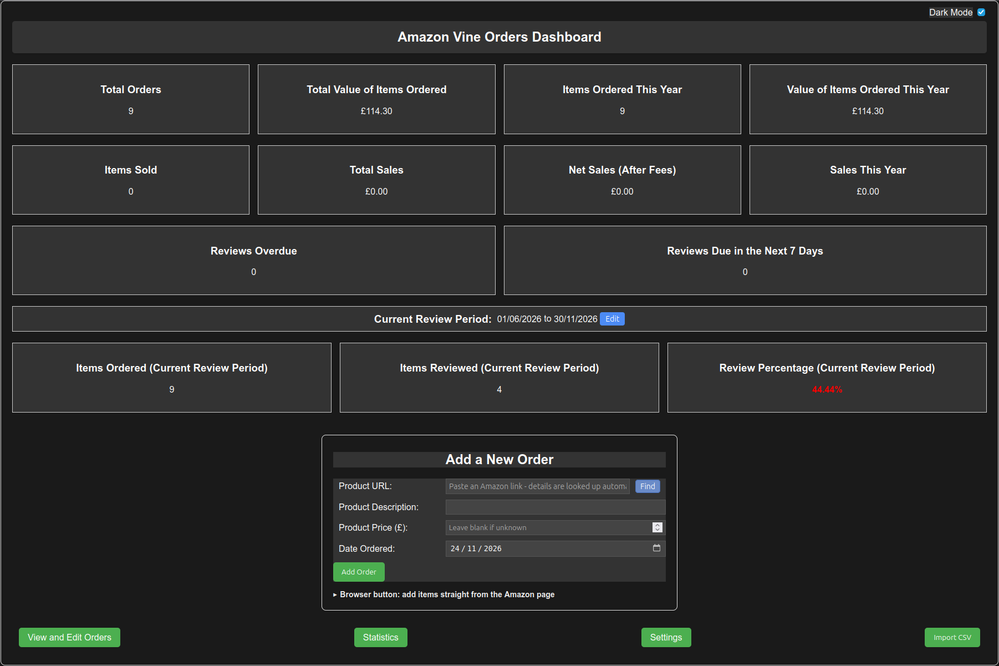
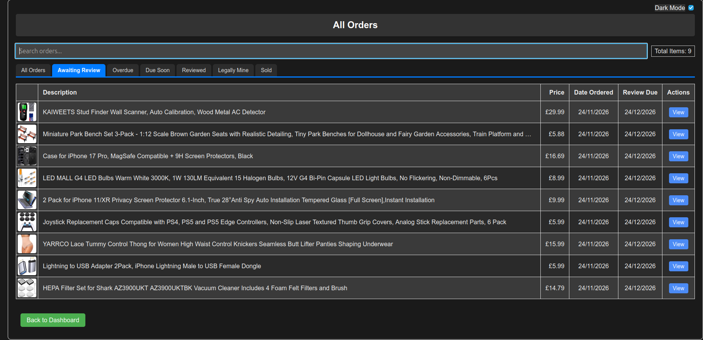
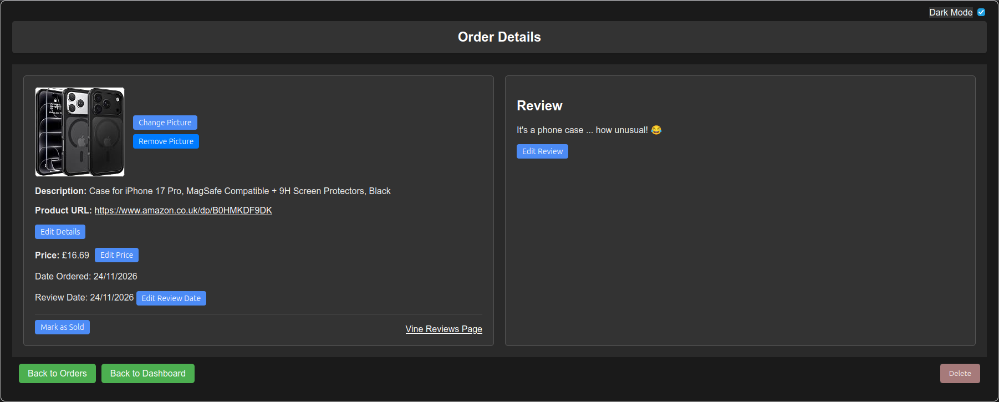
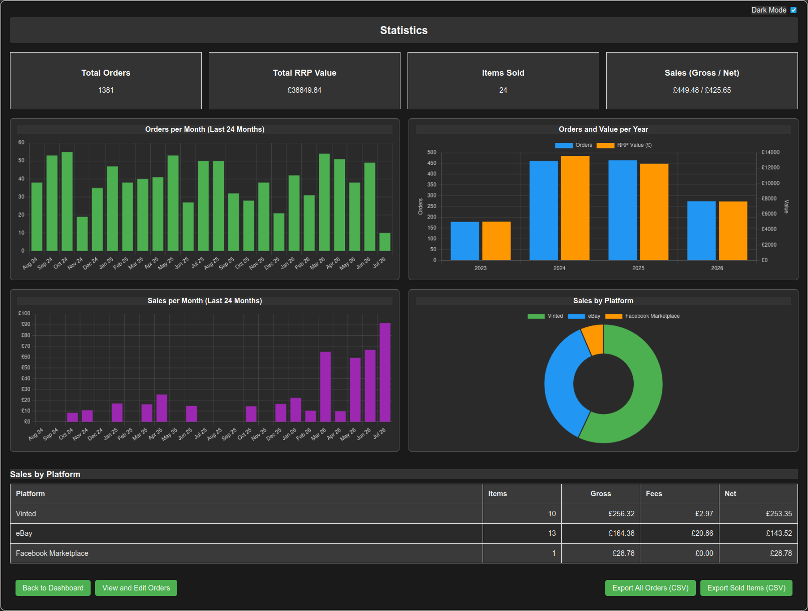

# vine-orders-app

A self-hosted web app to track your Amazon Vine orders, reviews and sales.

This Flask application was originally written almost entirely by ChatGPT. Other than fixing obvious mistakes I noticed it make, my only input was telling it what I wanted, liked and didn't like, a little bit of CSS and HTML and a lot of beta testing and banging my head on the table because, while ChatGPT is actually quite clever, it's also exceptionally stupid sometimes and has the memory retention of a fish! Version 2.0 added sales tracking and a general tidy-up, version 2.1 added a statistics page with charts and CSV exports, this time with help from Anthropic's Claude, and version 2.2 brought a much more reliable way of adding orders (including a browser button), product pictures, review reminders, optional backups and a Docker Compose file.

## Features

- **Dashboard** with statistics: total orders, total value, items ordered this year and their value
- **Review period tracking** - set your six-month evaluation period and see items ordered, items reviewed and your review percentage at a glance (green when you're meeting the 80-item / 90% requirements, red when you're not)
- **Add orders** by pasting the Amazon URL - the description and price are looked up automatically, with a one-click browser button as a more reliable alternative and a warning if you've already got the item
- **Review management** - write reviews in Markdown with a built-in editor, track review dates and due dates
- **Review reminders** - the dashboard shows how many reviews are overdue or due in the next 7 days, overdue and due-soon orders are highlighted in the orders list, and there are filters for each
- **Edit order details** - fix the description, URL or order date of any order
- **Product pictures** - a small picture of each item in the orders list and on its page, using only a link to Amazon's own image (no pictures are stored on your server), plus a Picture Catch-up that fills in pictures for older orders in the background
- **Ownership tracking** - each item shows when it becomes legally yours (six months after the review date), with an "Items Legally Mine" filter
- **Sales tracking** - mark items as sold with the date, sale price, platform and optional fees. The platform is free text with autocomplete from your previous entries, so it works with eBay, Vinted, Facebook Marketplace or anywhere else you sell. The dashboard shows items sold, total sales, net sales after fees and sales this year, and the orders page has a Sold Items filter
- **Statistics page** with charts covering orders per month, orders and value per year, sales per month and sales by platform, plus a per-platform breakdown of gross, fees and net
- **CSV exports** of all orders, or just your sold items with net amounts worked out
- **Search and filters** with pagination and a page-jump box for large collections
- **CSV import** for your Amazon data export, plus a separate script to bulk-import prices
- **Optional daily backups** to a folder of your choice, plus a button to download a copy of the database whenever you like
- **Dark mode**, because of course

A few images of the app:






## Installation

This is a Python project so you will need to install Python if it is not already installed. I used 3.12 for my Docker setup but any recent version should work. See [Python.org](https://www.python.org/downloads/). Linux users should already have Python installed so can move straight to the next step.

To install the dependencies in requirements.txt you will need pip. Please see the [pip documentation](https://pip.pypa.io/en/stable/installation/).

If you want to run this script as a Docker container you will also need to install Docker. Instructions can be found on the [dockerdocs website](https://docs.docker.com/engine/install/).

Once installed you simply need to run app.py from the command line / terminal (which will start the simple web server). This will either be in the form of 'python app.py' or 'python3 app.py', depending on your Operating System. Once you have it working you can add a desktop shortcut to launch it if you are not running it 24/7 in a Docker or other web server. The other alternative is to set it up as a scheduled task (Windows) or cron job (Linux) so it starts at login.

If you are running the app on your local machine then it will be available in your web browser at http://127.0.0.1:5000/. Substitute the IP address if you are running the app on a different machine. The port number can also be changed by editing app.py. At the very bottom of the script you will see the line:

> app.run(host='0.0.0.0', port=5000)

Change the port number as required, save the file and then restart the app and adjust the browser URL port.

## Running in Docker with Docker Compose

The app comes with a `docker-compose.yml` file, which tells Docker both how to build the app and how to run it (the port, the folders it uses, the time zone and restarting automatically). With the app's files in a folder on your server, open a terminal in that folder and run:

```
docker compose up -d --build
```

That's it - the app is then available at `http://<server address>:5000`. To update to a new version, copy the new files into the same folder and run the same command again.

A few things worth knowing:

- **Your data stays in the app's folder.** The folder is used directly by the container, so the database (and the `backups` folder, if you use it) lives on your server and survives rebuilding the container.
- **Port and time zone** can be changed in `docker-compose.yml` - the comments in the file explain how. The time zone is set to `Europe/London`.
- **Backing up to another folder:** the file has a commented-out line for a backup folder outside the app's folder (e.g. `/mnt/user/Backup:/backups`). Change the left-hand side to your folder, remove the `#`, run the command again, then enter `/backups` as the backup folder in Settings.
- **Unraid:** the `docker compose` command comes from the *Docker Compose Manager* plugin in Community Applications. If you already run the app from an Unraid container template, stop and remove that container first (your files in appdata are not touched), as both would want port 5000.
- Other handy commands, run from the same folder: `docker compose logs -f` (watch the log), `docker compose restart` and `docker compose down` (stop and remove the container; your data is kept).

## Backups

The database (vine_orders.db) is created in the app's own folder the first time the app starts. If you run the app in Docker, make sure that folder is mapped to your server's storage (on Unraid, the appdata folder), otherwise rebuilding the image could lose your orders.

Automatic backups are optional and switched off to start with. Press 'Settings' on the dashboard to switch them on, choose the backup folder and how many backups to keep (14 to start with). Once a day the app then saves a copy of the database named by date (e.g. `vine_orders-2026-11-19.db`) and deletes the oldest copies beyond the number you're keeping. The Settings page lists your backups and shows the full folder they are saved in, and has buttons to save the settings and back up immediately, or download a copy of the database. If the app is running in Docker and the backup folder is not inside a mapped Path, it warns you, as backups saved there would be lost when the container is rebuilt.

The backup folder can be `backups` (a folder inside the app's folder) or any full path the app can write to. In Docker the app can only see folders the container has been given, so to back up to a different share, add a Path to the container (for example container path `/backups`, host path `/mnt/user/backups/vine-orders`) and enter `/backups` as the backup folder.

To restore a backup, stop the app, replace vine_orders.db with the backup file (renamed to vine_orders.db) and start it again.

## Updating from an earlier version

Your existing database is upgraded automatically - the first time the new version starts it adds any new columns (such as the sales tracking columns in v2.0 and the picture column in v2.2) and tidies a few data quirks, with no manual steps needed. It's still sensible to take a copy of vine_orders.db first, as you should before any update.

If you run the app in Docker, **rebuild the image** when updating to v2.0 (pandas was removed and Flask was updated to 3.x) or v2.2 (the Dockerfile now adds time zone data) rather than just restarting the container. With Docker Compose, `docker compose up -d --build` does this for you.

If you set up the browser button before v2.2, drag it to your bookmarks bar again after updating - the app will tell you if you're using an old copy.

## Import Vine Orders

While this was initially a hidden function, I received a request to add a button on the index page that allows you to import Vine orders. This should only import items where the URL does not already exist in the database.

First, download your data from Amazon. There should be a VineOrders.csv file, or something similar (rename it to VineOrders.csv if it has a different filename) which would have columns for url, date_ordered and description. Move this file to the root folder of the app (where app.py is) then press the 'Import CSV' button. If everything is in place you should see a popup message either confirming the data has been imported, including any new records that do not exist in the database, or that VineOrders.csv is missing from the root folder.

## Import Prices

There is also a separate Python script to import prices (import_prices.py). This exists because when I started playing with the program I only had the Amazon data that I requested which, as Vine items are free, all shows £0.00. I was considering manually entering all the prices, and started to do so. I then got exceptionally bored and, as I had another CSV file that I had been using up to that point that contained most of the prices, decided to have a script written to match the URLs and import the relevant prices. It expects a prices.csv file with url and price columns in the app's root folder.

## Product Pictures

When you add an order with the browser button (or the Find button, when Amazon lets it through), the app picks up the product's main picture and shows a small preview on the form. Only the picture's address is saved - a short line of text pointing to a small (160 pixel) version of Amazon's own image - so pictures take up effectively no space and don't make backups any bigger. Small pictures appear in the orders list and a larger one on each order's page.

If you're offline, or Amazon ever removes a picture, a grey placeholder is shown instead and everything else carries on working.

To add a picture to an order you already have, open the order and press 'Add Picture'. You can either press 'Fetch from Amazon' to have the app try to get it automatically (Amazon sometimes blocks this), or right-click the main product picture on the Amazon page, choose 'Copy Image Link' (Firefox) or 'Copy image address' (Chrome) and paste it in - that always works. The same buttons let you change or remove a picture.

If you use the browser button on an item you've already got, the app warns you and asks before adding a second order for it.

### Picture Catch-up

If you have lots of orders without pictures, the **Picture Catch-up** on the Settings page fills them in for you. It looks up each order's Amazon page in turn, newest orders first, and saves the picture. To avoid bothering Amazon it goes slowly, one order at a time, with a pause between each (30 seconds unless you change it; each pause varies a little either side). With over a thousand orders that's an overnight job, but it carries on in the background on the server, so you can close your browser and check on it later.

If Amazon starts showing its "are you a robot?" page, the catch-up waits (10 minutes, then 20, then 30) and tries the same order again. If it's blocked four times in a row it stops and suggests trying again later. Press Stop at any time; pressing Start carries on from where it got to. Orders whose Amazon page has no picture (for example, products that have been removed) are remembered so they're not looked up again - tick 'Also retry orders where no picture was found before' to give them another go.

If you set up the browser button before version 2.2, drag it to your bookmarks bar again, as the new version also sends the picture.

## Review Reminders

Vine asks for a review within 30 days of ordering. The dashboard has two boxes showing how many unreviewed items are overdue and how many fall due in the next 7 days; click either to see the items. In the orders list, overdue items are highlighted in red and those due soon in amber, with a Review Due column, and the 'Overdue Reviews' and 'Reviews Due Soon' filters list them oldest first so the most urgent are at the top. Each order's page also says how many days are left (or how overdue it is).

## Sales Tracking

Open any order and press 'Mark as Sold'. Enter the date sold (defaults to today), what it sold for, the platform and any fees, and save. The order page then shows the sale details including the net amount after fees, with buttons to edit or clear the sale if you make a mistake. Sold items appear under the 'Sold Items' filter on the orders page, and the dashboard totals update automatically.

There's no hard enforcement of the six-month ownership rule - the app shows you the ownership status and politely assumes you know what you're doing.

## Statistics and Exports

If you like your data, there's a 'Statistics' button on the dashboard. It opens a separate page with charts for orders per month, orders and RRP value per year, sales per month and a breakdown of sales by platform, along with a table showing gross, fees and net for each marketplace you've sold on. The charting is done with [Chart.js](https://www.chartjs.org/), which is bundled with the app rather than loaded from a CDN so everything continues to work offline.

At the bottom of that page are two export buttons. 'Export All Orders' gives you a CSV of everything in the database, useful for backups or if you fancy doing your own analysis in a spreadsheet. 'Export Sold Items' gives you just the items you've sold, with the date, platform, sale price, fees and calculated net amount, which is a sensible starting point if you ever need records of your selling income.

## Adding Orders: the Find Button and the Browser Button

Paste an Amazon link into the Product URL box and the app looks the product up straight away (or press Find / Enter). Long links full of tracking codes are tidied to the short `amazon.co.uk/dp/ASIN` form, short links from the Amazon app's Share button are followed, and you're warned if you've already got the same item in the database. If no price is found the box is left blank rather than set to £0.00 - you can add the order without a price and fill it in later.

Amazon doesn't like automated visitors, so sometimes it answers with its "are you a robot?" page instead of the product. The app now recognises this and tells you, rather than quietly returning nothing. Vine items also often have no price on Amazon until they go on general sale, so a missing price isn't always the app's fault.

For the most reliable results, use the **browser button**. Open "Browser button" under the Add a New Order form and drag the orange "Add to Vine Orders" button to your bookmarks bar. Then, on any Amazon product page, click it. The app opens in a new tab with the description and price already filled in from the page you were looking at, so Amazon's bot checks never come into it.

## Reporting Problems and Suggesting Ideas

Found a bug, or have an idea for the app? Please [open an issue](https://github.com/infidelus/vine-orders-app/issues/new/choose) and pick the form that fits - there's one for general bugs, one for the Find button or browser button getting product details wrong, and one for feature ideas.

## Thanks

Thanks to Reddit user AussieA1 who shared the code from the Python tkinter app he created himself that gave me the idea for this app, and which helped me get the Find button working to scrape the description and price from the Amazon website.
